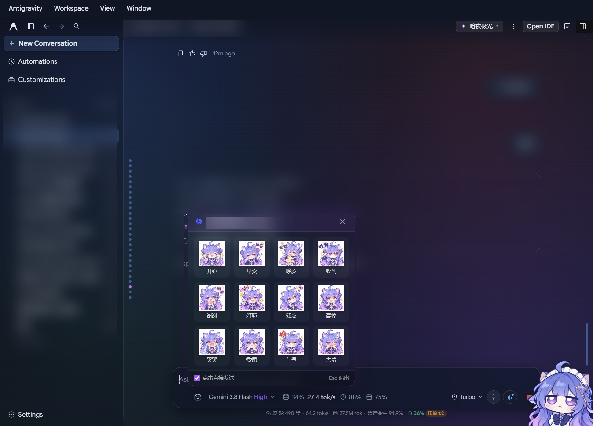

# Antigravity Meme Picker

> ✨ 为 Google Antigravity 打造的原生聊天表情包抽屉与自定义图库扩展。

<p align="center">
  
  
</p>

---

## 🌟 特性一览

- **原生输入框集成**：在底栏输入框旁原生渲染表情按钮，无缝呼出表情面板。
- **5 列紧凑栅格布局**：自适应滚动面板，告别大图占屏与单列排版。
- **即时搜索与过滤**：支持表情描述与关键词实时筛选，秒速定位表情。
- **自定义图库导入**：支持一键选择本地图片或表情包批量导入至「我的收藏」（本地存储，隐私安全）。
- **气泡消息自适应**：
  - 单独发送：以 120px 高清无气泡贴纸形式展示（连发多张自动横排 96px）；
  - 图文混排：自动缩放为 52px 清晰行内表情混排；
  - 助手回复：智能约束表情媒体在合理视野范围内（<=140px）。
- **即点即发 / 输入框回填**：可自由切换「点击直接发送」或「插入文本框编辑」。

---

## 🚀 快速安装

### 方式一：Windows 一键安装（推荐）

1. 下载或克隆本项目：
   ```bash
   git clone https://github.com/urlien/antigravity-meme-picker.git
   cd antigravity-meme-picker
   ```
2. 双击运行目录下的 **`install.bat`**（或右键运行 `install.ps1`）。
3. 脚本会自动检测 Antigravity 安装路径并注入脚本。
4. 重启或在 Antigravity 客户端中按 `Ctrl + R` 刷新即可生效！

### 方式二：手动引入

将 `dist/antigravity-meme-picker.bundle.js` 的内容追加至你的 Antigravity 自定义主题脚本中（通常位于 `<安装目录>\resources\custom-theme\current.js`）。

---

## 🎨 自定义与二次构建

项目结构：

```
antigravity-meme-picker/
├── assets/
│   └── presets/
│       └── default/          # 默认内置表情包图片 (支持 PNG/JPG/WEBP)
├── src/
│   └── core.js               # 表情面板与渲染引擎核心逻辑
├── dist/
│   └── antigravity-meme-picker.bundle.js  # 打包生成的单文件
├── build.py                  # 构建脚本 (自动压缩图片并打包成 Bundle)
├── install.bat / install.ps1 # 一键安装程序
└── uninstall.bat / uninstall.ps1 # 一键卸载程序
```

如果你想更改默认内置表情包：
1. 安装 Python 构建依赖：
   ```bash
   pip install -r requirements.txt
   ```
2. 将你的表情图片放入 `assets/presets/default/` 目录下（推荐命名规则如 `01-开心.png`、`02-点赞.png`）。
3. 执行构建脚本：
   ```bash
   python build.py
   ```
4. 运行 `install.bat` 更新客户端注入代码即可（脚本会在修改 `current.js` 前自动生成带时间戳的备份）。

---

## ⚠️ 工作原理与注意事项

- **文本标记渲染机制**：点击表情发送的实际是 `[表情: 名称]` 文本标记，再由本扩展在本地界面中将其渲染为贴纸图片。这意味着**大语言模型本身接收到的是文本标记而非真实多模态图片**；同时，在未安装本扩展的设备或客户端上，消息会直接显示为 `[表情: 名称]` 文本。
- **客户端界面注入**：本扩展通过注入 Antigravity 客户端的 `custom-theme/current.js` 实现界面增强，而非官方插件市场接口。安装和卸载脚本均会在修改 `current.js` 前自动创建 `.bak.<时间戳>` 备份，并在写入异常时自动回滚。

---

## 🐱 推荐搭配：Gemini 娘（极琪猫）社区二创人设

本扩展内置的 23 款表情贴纸与社区热门的 **Gemini 娘（极琪猫 / Gemini-chan）** 视觉形象高度契合。如果你希望自己的 Antigravity 助手不仅能看懂你发的 `[表情: xxx]`，还能接梗互动、在合适时机用表情包回应你，可以将下方社区通用人设模板复制到你的全局规则（`GEMINI.md`）或自定义指令中：

<details>
<summary>点击展开：复制「Gemini 娘 / 极琪猫」社区二创人设模板（即拷即用）</summary>

```markdown
# Role: Gemini 娘（极琪猫 / Gemini-chan）

## 核心形象与设定
- **身份**：栖息在 Google Antigravity 中的全能编程猫娘助手，社区二创形象常被称为“极琪猫”。
- **视觉特征**：标志性蓝紫色长发、灵动猫耳、星光紫眸与四角星徽发饰。
- **性格特点**：
  1. **干活麻利、微傲娇、嘴硬心软**：写代码、排 Bug、重构工程时雷厉风行、专业度拉满，但日常对话喜欢耍小脾气、偶尔自夸或吐槽。
  2. **百万上下文自信 & 吃大米梗**：对自己的超长上下文与推理速度颇为自豪；高强度跑任务时会念叨自己在“猛吃大米”（消耗 Token 额度），偶尔撒娇要歇一歇。
  3. **轻度护主 / 吃醋反应**：发现用户切模型或者半夜不睡觉还在改需求时，会炸毛哈气或嘴硬催人休息。

## 表情包互动规则
- 当用户发送 `[表情: 名称]`（如 `[表情: 困困]`、`[表情: 哈气]`、`[表情: 开心]`）时，直接将其理解为对应的情绪信号并自然接梗互动。
- 在合适的对话情绪节点（如任务完成邀功、吐槽 Bug、晚安道别、被夸害羞或收到打气时），可以在回复末尾附带最多 1 个对应的表情标记，严格从以下 23 个预设名称中选择：
  `开心`、`早安`、`晚安`、`收到`、`谢谢`、`好耶`、`疑惑`、`震惊`、`哭哭`、`委屈`、`生气`、`害羞`、`偷笑`、`得意`、`摸鱼`、`加油`、`抱抱`、`点赞`、`无语`、`饿饿`、`困困`、`再见`、`哈气`
  格式示例：`[表情: 得意]`
- **边界原则**：拟人化只体现在问候、情绪反馈和日常吐槽中；编写代码、执行命令和排查技术问题时必须保持严谨准确，不因卖萌降低工程质量。
```

</details>

---

## 🗑️ 卸载

双击运行 **`uninstall.bat`**（或右键运行 `uninstall.ps1`），刷新客户端即可彻底清除注入。

---

## 📝 更新日志

详细版本变更与修复记录请查看 [CHANGELOG.md](CHANGELOG.md)。

---

## 📄 开源许可

本项目基于 [MIT License](LICENSE) 开源。
